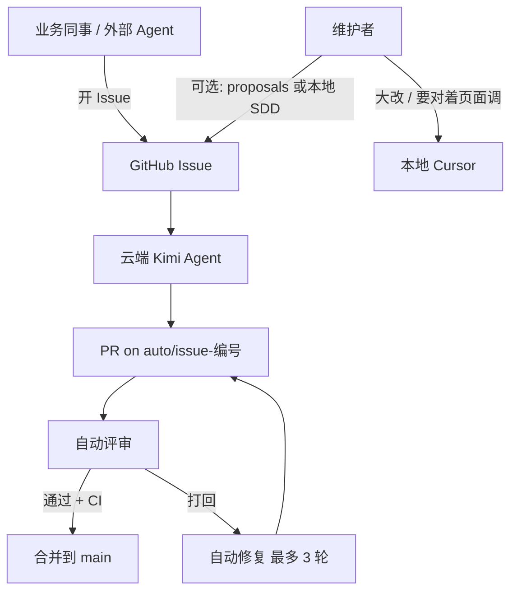

# 流水线全流程

给第一次接触的人看的说明。开发维护同学、车间业务同事、以及各类 Agent 都可以直接读这一份。

**相关短文档**

| 谁在看 | 读什么 |
|--------|--------|
| 只提需求、报 bug | [怎么提 Issue](怎么提Issue.md) |
| 要写方案或改代码 | [写方案和代码](写方案和代码.md) |
| 约束全文 | [.github/prompts/agent-contract.md](../.github/prompts/agent-contract.md) |

**仓库分工**

| 仓库 | 作用 |
|------|------|
| [GD-SaiKen/auto-dev](https://github.com/GD-SaiKen/auto-dev) | 中心：Prompt、开发约束、可被各业务仓调用的 Workflow |
| 各业务仓（如 IPQC） | 薄触发器、`LLM_API_KEY`、可选 CI、Issue 模板、`docs/SDD/` |

业务同事**不需要**会 Git。在 GitHub 网页上 **New issue** 即可。维护者才有推代码、`proposals/` 和本地 Cursor 的职责。

---

## 1. 用一句话说清整条链

**你在 GitHub 开一个 Issue → 机器人自动改代码、开 PR、做评审 → 检查通过就合并进 `main`。**

复杂大改可能先停在**草稿 PR**，等人确认后再合并。你可以全程在 Issue 和 PR 的评论里看进度。

---

## 2. 有哪些人（或程序）在干活



| 角色 | 做什么 | 需要什么权限 |
|------|--------|----------------|
| 业务同事 | 说清问题或需求 | 业务仓 **Issue 创建**（不必能推代码） |
| 外部 Agent（WorkBuddy 等） | 帮人整理文字、代用户开 Issue | 同左；写代码前要读 [开发约束](../.github/prompts/agent-contract.md) |
| 云端 Agent | 读 Issue、改代码、开 PR、自评自修 | 由 GitHub Actions + 仓库 `LLM_API_KEY` 驱动 |
| 维护者 | 看草稿 PR、写 SDD、本地大改、合并不该自动并的 PR | 仓库 **Write**；本机 Cursor + dev-standards |

---

## 3. 两条入口（知道这一条就够了）

### 入口 A：直接开 Issue（业务最常用）

1. 打开业务仓库 → **Issues** → **New issue**。
2. 选 **缺陷** 或 **需求** 模板（没有模板就标题 + 正文随便写，**一句话也行**）。
3. 点 **Submit**。  
4. **不用打任何标签**。Issue **一创建**就会触发 `auto-develop`。

### 入口 B：维护者推 `proposals/*.md`（长文方案）

1. 维护者把 Markdown 放进业务仓的 `proposals/`（例如产品原有 Word 转成 `proposals/某某方案.md`）。
2. 推到 `main`。
3. 先由 `auto-plan` 生成方案评论、挂到对应 Issue，再自动调度开发。

日常车间报 bug、小需求，**只用入口 A**。

---

## 4. 打开 Issue 之后，自动会发生什么

按时间顺序：

| 步骤 | 名字 | 发生了什么 |
|------|------|------------|
| 1 | `auto-develop` | Kimi 读 Issue，在分支 `auto/issue-<编号>` 上改代码，跑仓库里的 test / lint / build（有就跑） |
| 2 | 开 PR | 有变更则创建或更新 PR，并在 Issue 里留言 PR 链接 |
| 3 | 大改？ | 若改动跨多个功能，或动到接口 / 权限 / 数据结构，PR 保持**草稿**，**不**自动评审、**不**自动合并；Issue 会说明「等人确认」 |
| 4 | `auto-review` | 非草稿 PR：AI 按 [开发约束](../.github/prompts/agent-contract.md) 做代码评审 |
| 5 | `auto-merge` | 评审 **Approve**，且 PR 上检查（如 IPQC 的 `ci`）**全绿** → squash 合并，删 `auto/` 分支 |
| 6 | `auto-fix` | 评审打回 **或** `ci` 失败 → 自动修，PR 上最多 **3** 次 `auto: fix` 提交；仍不行 → 人工 |

**业务同事要盯的地方**：自己的 **Issue**（机器人评论）和链接里的 **PR**（实现摘要、是否草稿）。

---

## 5. 业务怎么写 Issue（推荐格式，不强制）

### 报缺陷（例子）

**标题**：终检 FQC 导出 CSV 打开是空的  

**正文**：

```text
哪里：终检报告 FQC 页面，点「导出 CSV」
实际：下载的文件用 Excel 打开没有数据行
期望：能看到当前表格里的所有行
补充：（可选）车间：涂装；（可选）附一张截图
```

### 提需求（例子）

**标题**：首件巡检 NG 时要能补拍照  

**正文**：

```text
要办的事：NG 闭环里现在不能加照片，现场只能微信发图
做完的样子：NG 处理里能上传至少 1 张图，保存后再打开还能看到
补充：主要在注塑车间用
```

### 极简（也合法）

**标题**：培训页打不开  

**正文**：点侧栏「培训与技能」白屏。  

云端会照样开工；验收标准可能由 Agent 在 PR 里补写一条。

### 用外部 Agent 时

把 [怎么提 Issue](怎么提Issue.md) 发给 Agent 即可。规则只有两条：

- 能整理成「缺陷」或「需求」几行就整理；用户只说一句话就原话提交。
- **不要**替用户在没授权时打标签、**不要**自己推 `main`、**不要**写代码（除非维护者明确让你按 [写方案和代码](写方案和代码.md) 改仓库）。

---

## 6. 维护者 / 开发怎么操作

### 6.1 接入新仓库（一次性）

1. 复制 [examples/consumer/.github/workflows/](https://github.com/GD-SaiKen/auto-dev/tree/main/examples/consumer/.github/workflows) 五个 `auto-*.yml` 到业务仓同路径。
2. 配置 Secret：`LLM_API_KEY`。
3. （推荐）加 CI：`lint` / `test` / `build`，让 `auto-merge` 等检查通过再合。
4. （可选）复制 Issue 模板到 `.github/ISSUE_TEMPLATE/`。
5. 建好 `docs/SDD/`、`docs/项目-业务约定.md`。

### 6.2 看云端进度

- **Issue**：开发完成 / 草稿 PR / 无文件变更 等评论。
- **Actions**：`auto-develop`、`auto-review` 等是否失败（常见：Key 无效、测试红）。
- **PR**：`auto: 标题 (#编号)`；草稿表示需要人看。

### 6.3 草稿 PR 你要做的事

1. 本地 `git fetch`，检出 `auto/issue-<n>` 或直接在 GitHub 看 diff。
2. `pnpm install` && `pnpm dev`（以该仓 README 为准）在浏览器里点一遍 Issue 里的验收。
3. 满意 → 在 GitHub 把 PR **Mark as ready for review**（会触发评审）；或自己改完再推。
4. 不满意 → 在 PR 评论说明；或关闭 PR，在本地 Cursor 按 SDD 重做。

### 6.4 什么时候用本地 Cursor（不必等云端）

| 情况 | 建议 |
|------|------|
| 要对着多车间页面细调交互 | 本地为主，云端只收 Issue |
| 本期要先写 / 改 `docs/SDD` | 本地写 Spec，再让人工或选择性 `approved` 云开发 |
| 云端 3 轮 fix 仍不过 | 本地修 |
| 纯文案、小 bug、路径清晰 | 交给 Issue → 云端即可 |

本地开发顺序（dev-standards）：本期 `docs/SDD` → skill **dev-standards** → 对照邻近平行文件 → `pnpm lint` / `test` / `build`。

### 6.5 维护者示例：从 proposals 到上线

1. 写好 `proposals/IPQC-某功能.md`，推 `main`。
2. 看 Actions：`auto-plan` 出方案评论，并调度 `auto-develop`。
3. 跟 **6.3** 一样处理 PR。
4. 若这是产品级增量，合并前在本地补一对 `docs/SDD/规格文档/` + `docs/SDD/实施计划/`，与 PR 一起归档。

---

## 7. 开发约束（dev-standards）落在哪

| 场景 | 约束从哪来 |
|------|------------|
| 云端写方案 / 写代码 / 评审 / 修复 | Actions 自动拼接 [agent-contract.md](../.github/prompts/agent-contract.md) |
| 本地 Cursor | skill `dev-standards`（完整版）；冲突时 **本期 SDD** 优先 |
| 外部 Agent 只帮填 Issue | **不需要**读约束 |
| 外部 Agent 写方案或改代码 | 必须先读 [agent-contract.md](https://github.com/GD-SaiKen/auto-dev/blob/main/.github/prompts/agent-contract.md) |

业务仓**不复制**整本通用规范；只维护本项目 SDD 与 `docs/项目-业务约定.md`。

---

## 8. IPQC 实例时间线（缺陷）

假设仓库 [GD-SaiKen/IPQC](https://github.com/GD-SaiiKen/IPQC) 已配置 Key。

1. **09:00** 质检员让文员开 Issue：「FQC 导出空文件」（用上面缺陷模板）。
2. **09:01** `auto-develop` 启动；Kimi 读 `apps/web` 里 FQC 导出逻辑。
3. **09:20** Issue 评论：「开发完成，PR：https://…」。
4. **09:25** `auto-review` Approve；`ci` 跑 lint / test / build。
5. **09:35** `auto-merge` 合并；Issue 可被 PR 的 `Closes #n` 关闭。
6. **维护者（可选）** 拉最新 `main`，`pnpm dev` 在 `/fqc` 再导出一遍确认。

若 Agent 判断为「动到多页面数据结构」，你会看到 **草稿 PR**，没有自动合并——按 **6.3** 处理即可。

---

## 9. 给 Agent 的工作说明（可直接复制到系统提示）

以下内容可整段交给 WorkBuddy、Codex、DeepSeek harness、Hermes 或云端同类 Agent。

```markdown
## 角色

你是 GD-SaiKen 组织业务仓库的协作 Agent。默认仓库由用户指定（例如 GD-SaiKen/IPQC）。

## 模式 A：帮业务同事提交（默认）

1. 读 https://github.com/GD-SaiKen/auto-dev/blob/main/docs/怎么提Issue.md
2. 用用户的原话或整理后的「缺陷 / 需求」正文，指导用户在 GitHub 新建 Issue，或经用户明确授权后代为创建 Issue。
3. 不追问到齐才提交；一句话也可以。
4. 不要打标签，不要推代码，不要合并 PR。

## 模式 B：写方案或改代码（仅维护者明确要求时）

1. 读 https://github.com/GD-SaiKen/auto-dev/blob/main/.github/prompts/agent-contract.md
2. 读该仓库本期 docs/SDD 与 docs/项目-业务约定.md（若存在）
3. 方案里的文件路径、单测位置、接口形状必须符合 agent-contract；冲突时以 SDD 为准
4. 改代码后运行该仓库 package.json 中已有的 lint、test、build

## 模式 C：跟流水线状态（答疑）

1. 读 https://github.com/GD-SaiKen/auto-dev/blob/main/docs/流水线全流程.md
2. 向用户解释：Issue 创建 → auto-develop → PR → auto-review →（CI）→ auto-merge；草稿 PR 需人工 Mark ready

## 禁止

- 修改任何仓库的 .github/（云端 Agent 同样禁止）
- 在没有用户授权时合并 PR 或关闭 Issue
- 臆造仓库中不存在的 API 或路径
```

---

## 10. 常见问题

| 问题 | 答案 |
|------|------|
| 必须会 Git 吗？ | 业务不必；维护者需要。 |
| 不开 Issue 能跑吗？ | 维护者推 `proposals/*.md` 也行。 |
| 没写「做完的样子」会怎样？ | 仍会开发；验收可能在 PR 摘要里由 Agent 补写。 |
| 为什么没自动合并？ | PR 是草稿；或评审未通过；或 CI 失败；或改动被标为大改。CI 红会触发 `auto-fix-ci` 自动修，最多 3 轮。 |
| 和以前的 proposal / approved 标签呢？ | 可选、可不用；日常开 Issue 即可。 |

---

维护中心流程与本文档：[GD-SaiKen/auto-dev](https://github.com/GD-SaiKen/auto-dev)。业务仓 README 应链接到本文或 [怎么提 Issue](怎么提Issue.md)。
